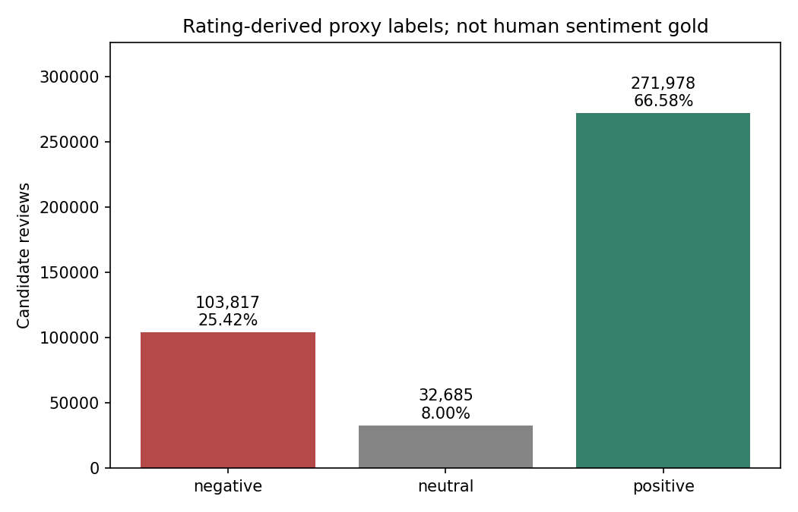
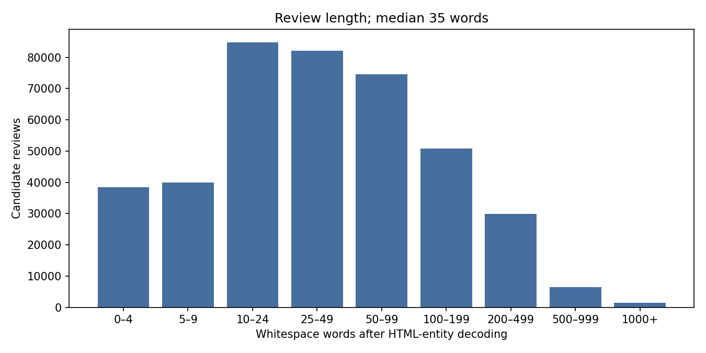
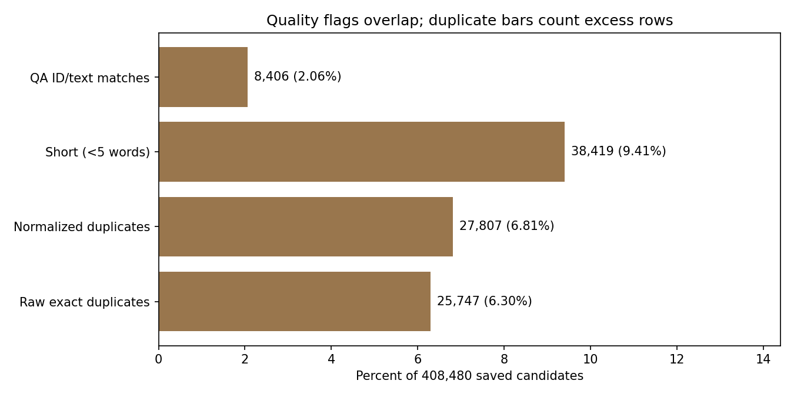

# Chất lượng ứng viên và mức độ sẵn sàng của phân chia — 2026-10-09

**chỉ đọc full-pool audit COMPLETE; clean-tiếng Anh dataset/splits/training chưa tạo.** Tiếp tục độc lập theo yêu cầu mới nhất dù P1 nghiệm thu còn NEEDS review. đầu vào saved408.480 valid các ứng viên,416.018.817 byte; SHA256/count khớp full-run bản kê. Không download/scan lại Amazon dump, không sửa nguồn text/filter/labels. Đây là ứng viên tập ứng viên của conservative siêu dữ liệu filter, chưa phải cuối cùng sạch dữ liệu.

## Thiếu, hiệu lực và sẵn sàng làm sạch

Required review_id/parent_asin/text/rating và optional asin/user_id/review_title/ timestamp/helpful_vote/verified_purchase không missing/null/whitespace blank trong tập ứng viên này. Required record types/rating1–5 PASS;0 trùng lặp review IDs,0 rỗng văn bản sau HTML-entity decoding/whitespace normalization. Đây là audit valid tập ứng viên, không đo thiếu của toàn raw nguồn hoặc260 selected-but-invalid đã bị loại.

Policy cho quy trình sau: malformed required field/invalid rating -> quarantine có lý do; rỗng normalized văn bản -> exclude có row-count ledger; optional null -> giữ null, không điền user/brand/date giả. Không xóa review ngắn tự động:38.419 records dưới5 whitespace từ (9,41%) có thể vẫn chứa cảm xúc hợp lệ.

HTML-tag regex candidates88.011 (21,55%); HTML-entity candidates15.573; URL963; Unicode replacement character4. Regex flags chưa chứng minh từng trường hợp là HTML/spam. Minimal normalizer hiện chỉ HTML-unescape + whitespace, giữ negation, punctuation và case; không strip tags/stem/delete stopwords.112.564 texts sẽ thay đổi bởi minimal chuẩn hóa nếu áp dụng; audit chỉ tạo keys, nguồn giữ nguyên. cuối cùng HTML handling phải preserve boundaries/negation/aspect vị trí cụm từ theo task. Language validity, semantic near-duplicates, spam và rating-text disagreement **NOT_MEASURED**; không claim tiếng Anh detection hoặc con người cảm xúc agreement.

## Trùng lặp và rò rỉ dữ liệu

| Khóa so trùng | Phím duy nhất | Nhóm trùng lặp | Dòng dư nếu giữ1/key | Nhóm sản phẩm chéo |
|---|---:|---:|---:|---:|
| Văn bản gốc chính xác | 382.733 | 7.465 | 25.747 (6,30%) | 3.540 |
| Thực thể HTML + khoảng trắng + trường hợp gấp | 380.673 | 7.390 | 27.807 (6,81%) | 3.479 |
| Khóa đề xuất dấu chấm câu | 376.424 | 7.520 | 32.056 (7,85%) | 3.655 |

Affected hàng khác excess hàng:33.212 raw-exact và35.197 normalized affected records.1.256 normalized trùng lặp groups có rating khác nhau; đây là đại diện-nhiễu ứng viên, không con người-nhãn disagreement.2.310 punctuation-key groups có distinct normalized variants; bỏ punctuation có thể thay cảm xúc, nên không loại trùng tự động hoặc coi là semantic gần trùng proof. Cluster CSV chỉ hashes/counts/ flags ở `data/interim/quality_audit/20261009/duplicate_clusters.csv`.

QA kiểm tra giới hạn registry dùng1.268 review IDs,1.503 sản phẩm,1.247 văn bản keys từ v1/v2 và full-survey labeled sản phẩm QA. Saved tập ứng viên chứa250 exact QA review IDs; normalized QA-text matches8.406 records, union ID/text8.406 (2,06%). sản phẩm matches65.983 (16,15%) chỉ là conservative product-exclusion scenario nếu cần không trùng sản phẩm giữa các tập; không khẳng định phải xóa tất cả những sản phẩm đó. Chưa áp dụng exclusion nào. phạm vi QA không phải sentiment/ABSA gold; không dùng QA nhãn gán làm huấn luyện nhãn hoặc tune filter trước completion of evaluation.

Để phân chia sau này: reserve evaluated review IDs và trùng lặp văn bản clusters; kiểm tra không trùng sản phẩm giữa các tập grouping kết hợp trùng lặp clusters, không stratify riêng từng review làm identical texts vào hai các tập đã chia. Chỉ khớp mô hình vectorizers/statistics trên tập huấn luyện. Persist train/validation/test70/15/15 và hạt giống ngẫu nhiên42 khi có cuối cùng tập ứng viên; ghi deviation/class coverage/group constraints. Không chia tập từ ứng viên tập ứng viên chưa validated-English/cleaned hoặc dùng test/gold để chọn policy/model.

## Chuẩn bị EDA/ML sơ bộ

Median35 từ; p90=189,p95=301,p99=669. Character median189,p95=1.655,p99=3.725. Đếm whitespace sau entity decode, chưa BERT token-length distribution. Long văn bản tail cần bộ tách token audit trên tập huấn luyện trước chọn max_length; chưa đặt BERT length. Timestamp range UTC2001-09-08 tới2023-09-09; chưa phân tích rating theo thời gian.

nhãn đại diện suy từ số sao số lượng: negative103.817 (25,42%), neutral32.685 (8,00%), positive271.978 (66,58%); largest/minority ratio8,32. Không phải con người cảm xúc. mất cân bằng có cơ sở để so sánh lớp weights trên tập xác thực sau phân chia; chưa chọn weights/resampling/baseline hoặc đo mô hình metrics. thương hiệu analysis trước giữ nguyên, không chạy lại hoặc suy ra complaint khía cạnh từ các tên nhóm có sẵn.







## các tệp kết quả, kiểm thử và giới hạn

Logic `src/data/quality_audit.py`, CLI `scripts/audit_candidate_quality.py`, vẽ biểu đồ CLI `scripts/plot_candidate_quality.py`; kiểm thử dữ liệu mẫu xác minh negation, trùng lặp số lượng, invalid bool-rating, QA rò rỉ dữ liệu union, rating map và byte nguồn unchanged. đã đo elapsed31,773s; peak working set424.853.504 byte dưới512MB ceiling. JSON có input/QA nguồn hàm băm, count/type phân bố, chuẩn hóa definition. Ba PNG đã kiểm tra trực quan, labels/denominators không clipping.

```powershell
.\.venv\Scripts\python.exe -B -m scripts.audit_candidate_quality --run-dir data/interim/feasibility/electronics_full_laptop_30k --output-dir reports/data_quality/NEW_AUDIT --clusters-output data/interim/quality_audit/NEW/duplicate_clusters.csv
.\.venv\Scripts\python.exe -B -m scripts.plot_candidate_quality --audit reports/data_quality/NEW_AUDIT/audit.json --output-dir reports/data_quality/NEW_AUDIT/figures
```

toàn bộ suite143 passed in3,65s;41 được bảo vệ checksums PASS, no phụ thuộc changed. ứng viên preflight không hoàn tất P2/P3 giai đoạn và không bỏ qua P1 acceptance. NEXT_ACTION: đã phê duyệt phạm vi coverage/brand decision và English/HTML/dedup policy, then có thể tái lập sạch bộ dữ liệu and rò rỉ dữ liệu-resistant phân chia. SemEval licence BLOCKED riêng; không tokenize/train hay xuất ABSA huấn luyện các tệp kết quả từ nguồn chưa authorized. laptop-only findings, nhãn đại diện suy từ số sao-nhiễu nhãn, SemEval-to-Amazon platform/style shift và small thủ công annotated bộ dữ liệu gold (hiện chưa có sentiment/ABSA gold) vẫn là giới hạn bắt buộc.
