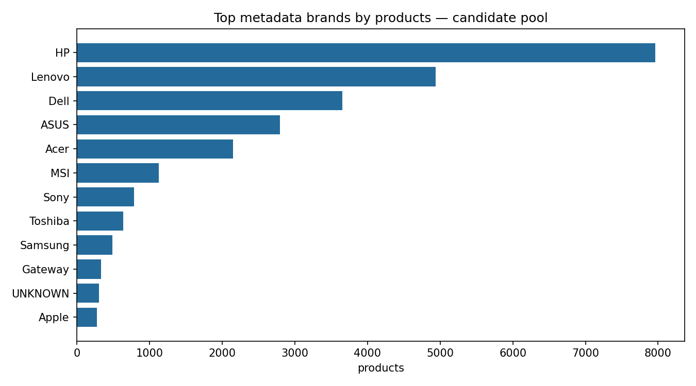
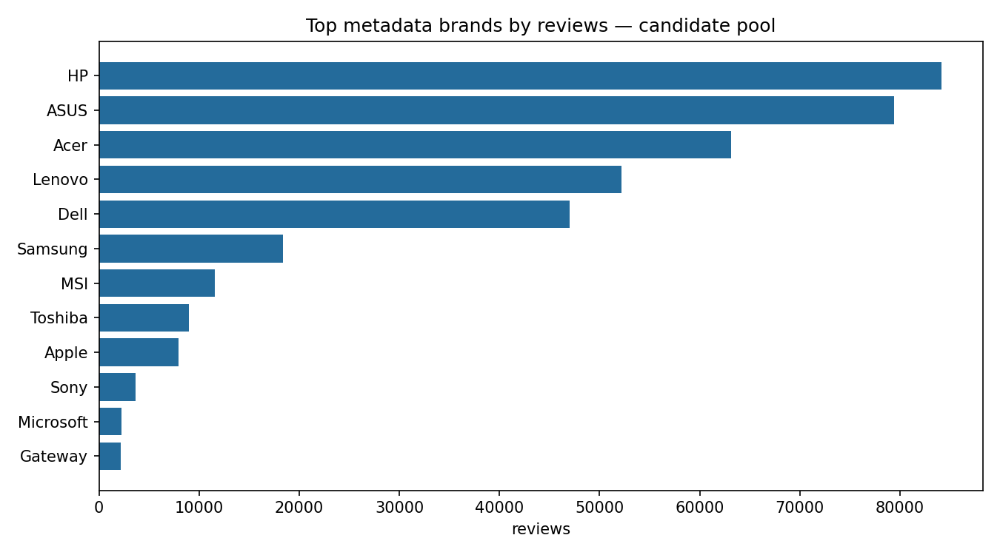
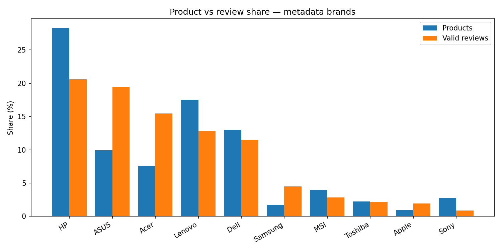
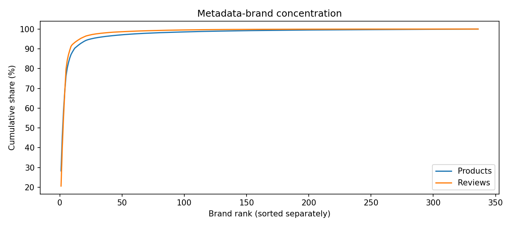
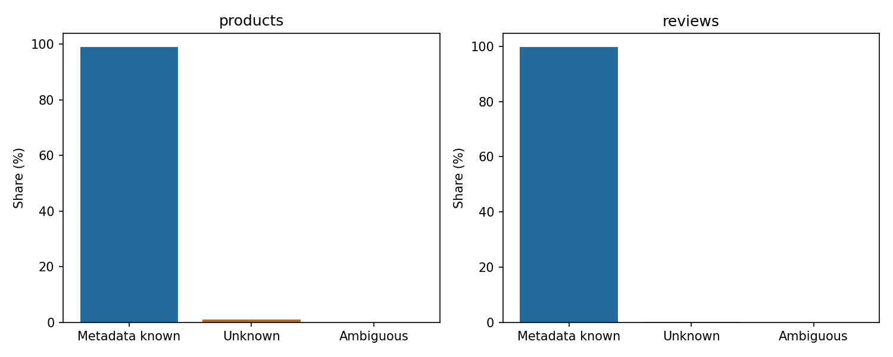

# P1 — Đa dạng thương hiệu trong nhóm ứng viên

Ngày 2026-10-08 (Asia/Saigon). **Analysis hoàn thành; nghiệm thu NEEDS review.** Nguồn saved `products.jsonl` và `laptop_valid.jsonl`, hàm băm đối chiếu full-survey report. Denominators: **28.172 unique được chọn sản phẩm**, **408.480 valid review**. 11 được chọn sản phẩm không có valid review vẫn được tính product-level, không review-level. Valid chưa có nghĩa sạch tiếng Anh hoặc independently validated laptop. Không chạy lại survey, đổi filter, loại sản phẩm hoặc cân bằng brands.

## Trích xuất thương hiệu và chuẩn hóa

Saved `brand` được quy trình lấy từ siêu dữ liệu `details.Brand` (dict hoặc decoded JSON string). Không dùng `store` làm brand. Giữ nguyên raw thương hiệu, NFKC/trim/collapse whitespace/casefold và exact documented aliases: HP/Hewlett-Packard/Hewlett Packard; ASUS/Asus; case variants Lenovo/Dell/Acer/Apple/MSI/Samsung và các thương hiệu khác. Không giới hạn vào danh sách ví dụ: mọi siêu dữ liệu thương hiệu khác vẫn có category. Casefold-only categories không chứng minh một manufacturer đã được xác minh. Không merge theo fuzzy string; ví dụ HP Tuners, Hewlett Packard Enterprise, ASUSLaptop hoặc Lenovo mô hình-like thương hiệu strings không tự gộp thành HP/ASUS/Lenovo.

Missing/generic/unbranded -> UNKNOWN; multi-brand delimiter strings -> AMBIGUOUS. Title token hints lưu riêng, chỉ exact boundary-matched recognized aliases; không điền lại siêu dữ liệu hoặc thay thương hiệu chắc chắn. Một hint không xác nhận manufacturer. Những khác biệt reseller/manufacturer hoặc bundled thương hiệu cần con người review.

**369 raw nonmissing thương hiệu strings ->336 normalized categories**, trong đó 334 siêu dữ liệu-brand categories không thuộc UNKNOWN/AMBIGUOUS. Không claim336 thực tế đã xác minh laptop manufacturers. 25.884 sản phẩm mapped qua known alias;1.975 giữ other siêu dữ liệu thương hiệu;300 missing/generic;13 ambiguous.236 unknown sản phẩm có single recognized title hint nhưng vẫn UNKNOWN.664 sản phẩm có metadata/title disagreement flag (~2,36%); đây là review queue, không bằng chứng xác nhận siêu dữ liệu sai.

## Cấp sản phẩm so với cấp review

| Thương hiệu | Sản phẩm độc đáo | review hợp lệ | Chia sẻ sản phẩm | Chia sẻ review |
|---|---:|---:|---:|---:|
| HP | 7.964 | 84.121 | 28,27% | 20,59% |
| ASUS | 2.792 | 79.393 | 9,91% | 19,44% |
| Acer | 2.148 | 63.161 | 7,62% | 15,46% |
| Lenovo | 4.940 | 52.182 | 17,54% | 12,77% |
| Dell | 3.656 | 47.000 | 12,98% | 11,51% |
| Samsung | 487 | 18.370 | 1,73% | 4,50% |
| MSI | 1.127 | 11.571 | 4,00% | 2,83% |
| Toshiba | 634 | 8.945 | 2,25% | 2,19% |
| táo | 277 | 7.943 | 0,98% | 1,94% |
| Sony | 786 | 3.626 | 2,79% | 0,89% |
| KHÔNG XÁC ĐỊNH | 300 | 1.237 | 1,0649% | 0,3028% |
| mơ hồ | 13 | 68 | 0,0461% | 0,0166% |

All-category counts/shares/deltas: `reports/tables/p1_brand_diversity_v1/brands.csv`. Raw mapping: `raw_brands.csv`; product-level provenance/title flags/review số lượng: `products.csv`; top-product số lượng: `top_products.csv`; methods/aliases/source hashes/concentration: `summary.json`. Không version copyrighted review văn bản mới trong thương hiệu báo cáo; sản phẩm IDs/titles là siêu dữ liệu-derived audit, không raw corpus.

| Nồng độ | Sản phẩm | review hợp lệ |
|---|---:|---:|
| Chia sẻ Top3, được sắp xếp độc lập | 58,78% | 55,49% |
| Chia sẻ top5 | 76,32% | 79,77% |
| HHI=tổng p2 | 0,14689 | 0,13762 |
| Entropy Shannon, log tự nhiên | 2,54647 | 2,40341 |
| Số hiệu dụng=exp(entropy) | 12,762 | 11,061 |
| Chia sẻ không xác định + mơ hồ | 1,1110% | 0,3195% |

sản phẩm top3 HP/Lenovo/Dell khác review top3 HP/ASUS/Acer. review top5 tập trung hơn nhưng review HHI thấp hơn vì product-level HP share lớn; không claim mọi concentration thước đo đều đi một hướng. Product/review total variation distance =0,23127; phân bố có chênh lệch đáng kể về representation. ASUS và Acer review share cao hơn sản phẩm share +9,53 và +7,84 percentage points; HP và Lenovo thấp hơn −7,68 và −4,76 points. Weight by review khác weight by sản phẩm, cần giữ hai perspectives khi thiết kế P2 lấy mẫu và phân tích lỗi.

Largest sản phẩm B009T3EYHO: **5.117 review,1,2527%** total; top10 products7,1247%, top10022,8256%. Không một sản phẩm chiếm majority corpus. High review số lượng không chứng minh bản trùng; exact/near trùng lặp audit **NOT_MEASURED**, thuộc P2. Apple/Gateway/Microsoft và long-tail siêu dữ liệu thương hiệu có representation nhỏ hơn leading brands. Không claim underrepresentation so với market share: không có market population comparator. Trong huấn luyện sau này, long-tail brands/products có thể ít số mẫu hỗ trợ và review-heavy thương hiệu có thể chi phối gradients/aggregate thước đo; hiện chưa huấn luyện hoặc đo brand-specific mô hình bias.

## Trực quan hóa

Standalone PNG+SVG, Matplotlib Agg; observed biểu đồ layout kiểm tra trực quan. biểu đồ dùng category/count dữ liệu, không con người nhãn giả hoặc trained predictions.











## Chấp nhận và đề xuất P2

Project yêu cầu preserve thương hiệu diversity nếu siêu dữ liệu hỗ trợ nhưng không có đã phê duyệt numeric threshold. **Analysis danh sách kiểm tra hoàn thành**, cuối cùng preservation/ nghiệm thu **NEEDS review**, không chuyển hiện có bảo toàn checkbox thành PASS. Proposed candidate-pool monitoring criteria, **chưa phê duyệt**: unknown/ambiguous <=5% ở cả levels; top5 review share<=90%; largest sản phẩm<=2% review; báo rõ long-tail coverage và metadata/title disagreement. Các mức này chỉ heuristic để phát hiện missingness/concentration lớn, không chứng minh representativeness, fairness hoặc sạch mẫu adequacy. thực tế ứng viên tập ứng viên nằm dưới các proposed limits, nhưng không dùng điều đó tự đóng gate.

Đề xuất P2 khi được phép: giữ raw/normalized/hint nguồn gốc, kiểm tra thương hiệu aliases và reseller/model-like outliers, báo cáo trước/sau làm sạch theo thương hiệu và rating, review/product giới hạn hoặc brand-aware lấy mẫu nếu quyết định được ghi rõ, không tự cân bằng ngay. Lập không trùng sản phẩm giữa các tập rò rỉ dữ liệu audit để tránh review-rich sản phẩm làm hiệu năng lạc quan. Không thương hiệu balancing/deduplication/training trong tác vụ này.

```powershell
.\.venv\Scripts\python.exe -B -m scripts.analyze_brand_diversity --output-dir reports/tables/NEW_BRAND_REPORT
```

đầu ra mới bắt buộc. Plotting phụ thuộc đã ghim phiên bản trong `requirements.txt`; `python -m pip check` PASS. Tests/gates ở `reports/p1_remaining_gates.md`. Limits: laptop-only findings; nhãn đại diện suy từ số sao-nhiễu nhãn; SemEval-to-Amazon platform/style shift within laptop review; small thủ công annotated cảm xúc/ ABSA gold chưa có. Không kết luận đại diện thị trường hoặc production readiness.
