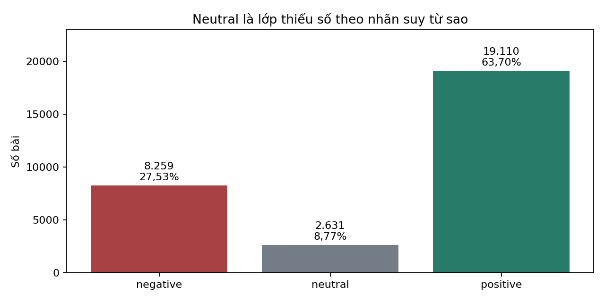
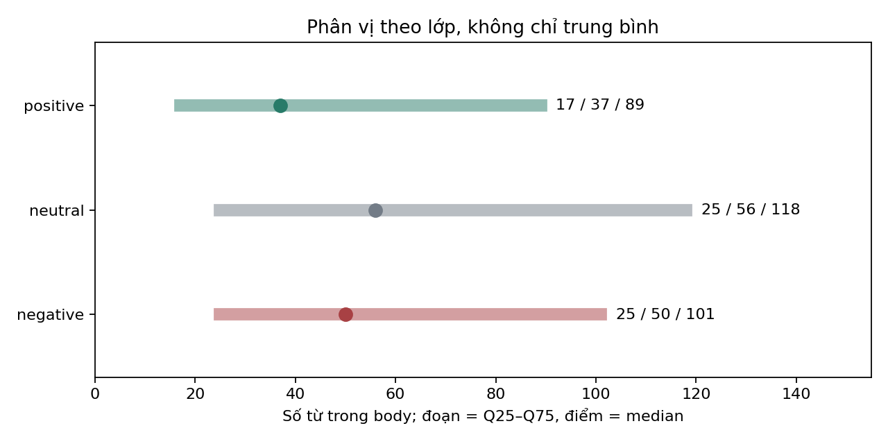
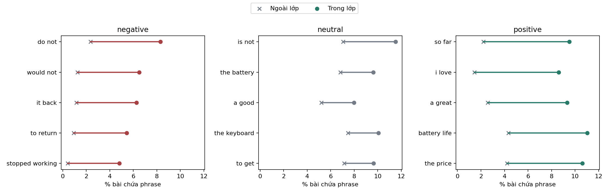

# P3 — EDA trọng tâm cho sentiment và ABSA laptop

Bản tinh gọn 2026-10-26, task `P3-REFINE-01`. Quan sát gốc từ P3 ngày2026-10-09; các liên hệ P4–P9 bên dưới được bổ sung hồi cứu, không viết lại điều P3 đã biết. Bộ bảng/hình gốc và báo cáo cũ giữ nguyên. Dataset/split/model/benchmark không đổi.

## 1. Mục tiêu và phạm vi

Giữ EDA giúp hiểu class imbalance, text/context, dấu hiệu từ vựng, concentration và proxy-label risk. Đây là phân tích mô tả toàn bộ30K đã khóa, không chọn đặc trưng/hyperparameters từ test. Không huấn luyện, chạy ABSA Amazon hoặc sinh nhãn người. Không dùng p-value để phóng đại chênh lệch nhỏ.

## 2. Dataset snapshot

**Observation:** 30,000 review laptop, 9,080 sản phẩm; ba nhãn suy từ sao.

**Evidence:** Bảng1 trích `sentiment.csv`; số sản phẩm từ `summary.json`.

**Interpretation:** Counts là mẫu đã qua lọc/sampling, không đại diện thị trường; số sản phẩm theo từng lớp có thể giao nhau.

**Project Impact:** Giữ negative/neutral/positive=0/1/2 và cùng mẫu số xuyên P4–P7; không relabel sau EDA.

| Nhãn proxy | Review | Tỷ lệ % |
| --- | --- | --- |
| negative | 8259 | 27,53 |
| neutral | 2631 | 8,77 |
| positive | 19110 | 63,70 |

## 3. Class imbalance và lựa chọn metric

**Observation:** Neutral chỉ8,77%; positive nhiều gấp7,26 lần neutral.

**Evidence:** Bảng1 và Hình1; đây là quan sát P3 gốc.

**Interpretation:** Accuracy chịu ảnh hưởng lớp lớn; macro F1/per-class F1 cần để nhìn minority. Imbalance là challenge có khả năng ảnh hưởng, chưa chứng minh nguyên nhân của lỗi.

**Project Impact:** P5/P6 so unweighted/balanced bằng validation; P7 báo neutral F1. Later confirmation: BERT overall chọn unweighted; P7 weighted validation macro F1 giảm, nên không mặc định weights giải quyết mọi lỗi.



## 4. Review length và độ phức tạp biểu diễn

**Observation:** Median body words negative/neutral/positive=50/56/37; IQR tương ứng76/93/72. Negative/neutral thường dài hơn ở trung tâm, nhưng IQR chồng lấn mạnh.

**Evidence:** Bảng2/Hình2 từ `length_by_sentiment.csv`, chỉ lấy word_count; Q25/median/Q75, không suy BERT tokens từ từ tách whitespace.

**Interpretation:** Chênh median13/19từ so positive đáng lưu ý về context; không đủ kết luận model sai vì review dài. Positive vẫn có đuôi rất dài; median không phản ánh truncation tail.

**Project Impact:** Later measurement: readiness canonical title+body có10,29% vượt256 và3,21% vượt512 BERT WordPiece. MiniLM256/BERT512 là context budgets khác; P4 đã chốt protocol, không đổi bằng EDA mới. Body median43 và canonical median48 không mâu thuẫn vì khác văn bản.

| Lớp | n | Q25 từ | Median từ | Q75 từ | IQR từ |
| --- | --- | --- | --- | --- | --- |
| negative | 8259 | 25 | 50 | 101.0 | 76.0 |
| neutral | 2631 | 25 | 56 | 118.0 | 93.0 |
| positive | 19110 | 17 | 37 | 89.0 | 72.0 |



## 5. Discriminative language — phrase có mẫu số

**Observation:** Phủ định/return nổi lên ở negative; các cụm khen và pin/giá nổi lên ở positive. Neutral không đồng nghĩa không có ngôn ngữ đánh giá.

**Evidence:** Bảng3/Hình3: top5bigrams mỗi lớp theo chênh prevalence trong–ngoài lớp, support trong lớp≥30; tie theo count giảm rồi term tăng. Không cố định phrase thắng.

**Interpretation:** Mỗi phrase đếm tối đa một lần/review, có mẫu số trong/ngoài lớp. Lift=(k+1)/(n+2) chia tỷ lệ ngoài lớp làm trơn tương tự; effect size là điểm %. Phrase có thể chồng lấn/ngữ cảnh phủ định; không causal hoặc feature importance.

**Project Impact:** Giữ negation/punctuation trong pipeline; dùng EDA để giải thích error patterns P7, không biến full-data lexical ranking thành chọn features có giám sát. Các phrase là body n-grams; không artifact ATE hoặc nhãn aspect.

| Lớp | Phrase | Trong lớp k/n | Trong % | Ngoài lớp k/n | Ngoài % | Δ điểm % | Lift làm trơn |
| --- | --- | --- | --- | --- | --- | --- | --- |
| negative | do not | 685/8259 | 8,29 | 515/21741 | 2,37 | 5,93 | 3,50 |
| negative | would not | 536/8259 | 6,49 | 272/21741 | 1,25 | 5,24 | 5,18 |
| negative | it back | 517/8259 | 6,26 | 254/21741 | 1,17 | 5,09 | 5,35 |
| negative | to return | 449/8259 | 5,44 | 202/21741 | 0,93 | 4,51 | 5,83 |
| negative | stopped working | 397/8259 | 4,81 | 92/21741 | 0,42 | 4,38 | 11,26 |
| neutral | is not | 303/2631 | 11,52 | 1933/27369 | 7,06 | 4,45 | 1,63 |
| neutral | the battery | 253/2631 | 9,62 | 1868/27369 | 6,83 | 2,79 | 1,41 |
| neutral | a good | 210/2631 | 7,98 | 1423/27369 | 5,20 | 2,78 | 1,54 |
| neutral | the keyboard | 265/2631 | 10,07 | 2044/27369 | 7,47 | 2,60 | 1,35 |
| neutral | to get | 254/2631 | 9,65 | 1956/27369 | 7,15 | 2,51 | 1,35 |
| positive | so far | 1817/19110 | 9,51 | 240/10890 | 2,20 | 7,30 | 4,30 |
| positive | i love | 1646/19110 | 8,61 | 158/10890 | 1,45 | 7,16 | 5,90 |
| positive | a great | 1780/19110 | 9,31 | 280/10890 | 2,57 | 6,74 | 3,61 |
| positive | battery life | 2107/19110 | 11,03 | 473/10890 | 4,34 | 6,68 | 2,53 |
| positive | the price | 2030/19110 | 10,62 | 459/10890 | 4,21 | 6,41 | 2,52 |



## 6. Negative failure signals

**Observation:** Top failure phrases theo quy tắc hiện tại chủ yếu là trả hàng và ngừng hoạt động; không có căn cứ buộc mọi nhóm overheating/software/keyboard đều nổi bật.

**Evidence:** Bảng4 lọc bigram/trigram theo regex failure trong config rồi xếp cùng effect-size/support. Ví dụ “to return” và “stopped working” được dữ liệu chọn; full regex và ngưỡng lưu trong config snapshot.

**Interpretation:** Đây là mention của dấu hiệu lexical, không đếm số sự cố đã xác minh. “to return” có thể nói trả hàng dự định, “not broken” có thể phủ định; các hàng overlap, không cộng thành prevalence complaint category.

**Project Impact:** P7 có thể tra context khi phân tích failure/return; chưa có human cause labels cho tổng thể. Không khái quát thành tỷ lệ hỏng laptop hoặc lọc dữ liệu/model theo complaint.

| Phrase | Negative k/n | Negative % | Ngoài k/n | Ngoài % | Δ điểm % | Lift làm trơn |
| --- | --- | --- | --- | --- | --- | --- |
| to return | 449/8259 | 5,44 | 202/21741 | 0,93 | 4,51 | 5,83 |
| stopped working | 397/8259 | 4,81 | 92/21741 | 0,42 | 4,38 | 11,26 |
| return it | 336/8259 | 4,07 | 150/21741 | 0,69 | 3,38 | 5,87 |
| a refund | 186/8259 | 2,25 | 29/21741 | 0,13 | 2,12 | 16,41 |
| returned it | 198/8259 | 2,40 | 65/21741 | 0,30 | 2,10 | 7,94 |

## 7. Positive value signals và aspect-like mentions

**Observation:** Trong positive, các chủ đề giá, tính di động và hiệu năng được nhắc với tỷ lệ cao hơn negative; battery life/the price cũng có effect size dương ở bảng phrase.

**Evidence:** Bảng5 giữ đủ9chủ đề của từ điển P3, không bỏ hàng không hợp kỳ vọng. Counts nêu mẫu số8259/2631/19110 ở bảng1; một review có thể nhắc nhiều chủ đề.

**Interpretation:** Đây là ứng viên để hỏi người dùng hài lòng về khía cạnh nào, chưa trả lời chắc “hài lòng vì gì”. Mention trong positive không đồng nghĩa aspect được khen: có thể có complaint hoặc so sánh bên trong. Không dùng keyword làm sentiment hoặc causal value driver.

**Project Impact:** Motivation cho P8/P9: cần trích span rồi phân loại có điều kiện theo aspect occurrence. Giữ kết luận ở mức lexical evidence đến khi có aspect-level gold/validation.

| Chủ đề từ điển | Neg count | Neg % | Neu count | Neu % | Pos count | Pos % |
| --- | --- | --- | --- | --- | --- | --- |
| battery | 879 | 10,64 | 491 | 18,66 | 3285 | 17,19 |
| build | 364 | 4,41 | 181 | 6,88 | 1023 | 5,35 |
| display | 2038 | 24,68 | 756 | 28,73 | 4931 | 25,80 |
| keyboard | 1153 | 13,96 | 605 | 23,00 | 3512 | 18,38 |
| performance | 1667 | 20,18 | 763 | 29,00 | 6020 | 31,50 |
| portability | 380 | 4,60 | 277 | 10,53 | 2954 | 15,46 |
| price | 1050 | 12,71 | 577 | 21,93 | 4921 | 25,75 |
| storage | 722 | 8,74 | 279 | 10,60 | 2224 | 11,64 |
| thermals_noise | 592 | 7,17 | 269 | 10,22 | 1553 | 8,13 |

## 8. Neutral-class characteristics

**Observation:** Neutral là2631review, tất cả rating3 do mapping; median56từ/IQR93, rộng hơn hai lớp còn lại. Top phrase gồm “is not”, “a good” cùng các cụm nhắc battery/keyboard.

**Evidence:** Bảng1–3/5: support và rates ở cùng dataset, không thêm annotation. Rating3 là định nghĩa proxy class, không phát hiện độc lập về cảm xúc.

**Interpretation:** Cả dấu hiệu khen/phủ định ở cấp lớp không chứng minh cùng một review chứa cả hai. Mixed-language rate, fact-like statements, weak sentiment, comparison và praise+complaint co-occurrence chưa được định lượng có nhãn; ghi NOT_MEASURED, không gán nhãn bằng trực giác.

**Project Impact:** Neutral cần per-class metrics và P7 human diagnosis. Later confirmation P7 cho thấy proxy–human mismatch; không quy toàn bộ khó khăn cho imbalance. Neutral ASC P9 thuộc SemEval aspect-level, khác Amazon overall neutral, không nhập hai population.

## 9. Concentration và khác biệt nhóm metadata

**Observation:** 5025/9080sản phẩm chỉ có1review; top100sản phẩm chứa5802/30000review; top5brand categories chứa23837/30000review.

**Evidence:** Bảng6 tổng hợp products/brands, không nhúng9080product rows hoặc xếp hạng theo sentiment.

**Interpretation:** Repeated products tạo dependence tiềm năng giữa review; singleton nhiều làm subgroup estimates không ổn định. Top5≈79,46% là selected-pool concentration, không market share hoặc bias đã đo theo hiệu năng.

**Project Impact:** P4 dùng product/variant/text groups và leakage audit. P2/P4 duplicate checks đã có: exact residual0 không đồng nghĩa semantic near-duplicate-free. Không sửa split hoặc brand quotas.

| Scope | Chỉ báo | Tử số/giá trị | Mẫu số | Tỷ lệ % |
| --- | --- | --- | --- | --- |
| product | products_total | 9080 | 9080 | 100,00 |
| product | singleton_products | 5025 | 9080 | 55,34 |
| product | top100_review_share | 5802 | 30000 | 19,34 |
| product | maximum_reviews_per_product | 100 | — | — |
| brand | top5_review_share | 23837 | 30000 | 79,46 |

**Observation:** Non-verified negative rate cao hơn verified10,30điểm%; median words102so38.

**Evidence:** Bảng7 có counts/mẫu số, cả neutral và độ dài; đây là chênh đáng lưu ý về composition, không chỉ chart trạng thái mua hàng.

**Interpretation:** Product mix/tuổi review/độ dài/exposure chưa kiểm soát; không kết luận non-verified giả hoặc xác minh làm sentiment tích cực hơn.

**Project Impact:** Giữ cả hai nhóm, không metadata feature trong active benchmark. Kết quả là caveat về selection/composition khi diễn giải P7, không đưa ra filter/model mới.

| Verified | n | Negative n | Negative % | Neutral n | Neutral % | Median từ |
| --- | --- | --- | --- | --- | --- | --- |
| False | 3650 | 1335 | 36,58 | 350 | 9,59 | 102 |
| True | 26350 | 6924 | 26,28 | 2281 | 8,66 | 38 |

## 10. Rating–text tension: quan sát gốc và xác nhận về sau

**Observation:** Original P3: nhãn suy từ sao và ví dụ context có thể khen/chê đan xen; chưa có human noise estimate đại diện.

**Evidence:** Later confirmation P7 ngày2026-10-25: disagreement68/360 chỉ mô tả mẫu gộp. SRS=31/300; enriched=37/60, phải tách scope. Nguồn `reports/p7_human_audit_results.json`, báo cáo P7 bên dưới.

**Interpretation:** P7 đo reused-test diagnosis, không whole30K noise rate và không independent P10gold. Khoảng tin cậy SRS trong P7 chỉ cho test population4500 và phụ thuộc nhãn người; không dùng pooled360 suy population.

**Project Impact:** Giữ provenance proxy trong mọi score; P7 phân biệt lỗi proxy và lỗi model; P10 vẫn cần independent human sentiment/ABSA gold. Không sửa rating/labels sau kết quả P7.

[P7 human diagnosis](../p7_error_cause_analysis.md); [P7 artifact](../p7_human_audit_results.json).

## 11. Motivation for downstream ABSA

**Observation:** Các phrase/aspect-like mentions phân biệt theo nhãn overall, nhưng một review có thể nhắc nhiều chủ đề và polarity khác nhau.

**Evidence:** Bảng3–5 là original lexical evidence. P3 context examples giữ ở appendix có status chưa aspect-labeled; không dùng kết quả model P8/P9 làm phát hiện P3 ban đầu.

**Interpretation:** Overall classification không xác định span hay sentiment của từng occurrence; từ điển chưa có precision/recall do người xác minh.

**Project Impact:** P8 cần span-level entity evaluation; P9 cần gold-aspect ASC và joint predicted spans riêng, policy conflict rõ. Không infer ABSA trên Amazon trong refinement này.

## 12. Bảy kết luận chính

- Neutral8,77% đòi hỏi macro F1/per-class F1; weighting phải chọn validation, không mặc định.

- Negative/neutral có median body dài hơn positive, nhưng IQR chồng lấn; không gán nguyên nhân lỗi model.

- Phrase failure/return có concentration trong negative, đo bằng tỷ lệ trong/ngoài lớp và support.

- Positive có lexical signals về pin/giá/di động/hiệu năng; chưa phải aspect sentiment hoặc causal value drivers.

- Neutral có wording đa dạng; rating3 không đảm bảo neutral theo text. Mixed/weak/factual causes vẫn chưa đo.

- Product/brand concentration và metadata-group differences giới hạn diễn giải, hỗ trợ group split thay vì brand ranking.

- P7 xác nhận proxy–human tension về sau; aspect-like evidence tạo động lực cho ATE+ASC, không thay human gold.

## 13. Cross-phase traceability

| P3 finding | Phase sau | Decision/diễn giải | Giới hạn thời gian và suy luận |
| --- | --- | --- | --- |
| Neutral minority | P5/P6/P7 | Macro F1 và per-class/neutral F1; thử weights chỉ train/validation | Quan sát cũ; không chứng minh causal imbalance |
| Median/IQR và đuôi dài | P4/P6 | Giữ context/negation; đối chiếu tokenizer max length đã khóa | Không đổi max_length bằng full-data EDA |
| Product/brand concentration | P4 | Product/variant-aware split; kiểm ID/text/near overlap | P4 đã thực hiện; EDA không chứng minh zero semantic leakage |
| Phrase phân biệt theo lớp | P7 | Ngữ cảnh chẩn đoán phủ định, failure, mixed wording | Không dùng full-data phrases làm selected features |
| Rating là proxy | P7/P10 | Human diagnosis; giữ independent gold riêng | P7 là xác nhận về sau, không thông tin P3 đã biết |
| Aspect-like language đa chủ đề | P8/P9 | ATE span-level + ASC theo occurrence | Động lực, không gold ABSA từ keyword |
| Verified-group khác cả độ dài | P7 | Nêu giới hạn composition; không metadata feature hoặc lọc lại | Liên hệ mô tả, không causal quality label |

P4: `reports/p4/p4_20261009_final/leakage_report.json`; P6: `reports/p6_transformer_benchmark.md`; P7: `reports/p7_error_cause_analysis.md`; P8: `reports/p8_aspect_extraction.md`; P9: `reports/p9_exp01_deberta_20261026_v2/report.md`. Đây là traceability hồi cứu, không xác nhận EDA gây ra mọi quyết định. Dataset/split/context budgets và model selection đã khóa vẫn giữ nguyên.

## Appendix — audit tham khảo, không core findings

Sáu bảng được demote và hai hình gốc giữ nguyên trong `../p3/20261009_verified/`:

- [rating.csv](../p3/20261009_verified/rating.csv) — Tra mapping sao; trùng class snapshot; P2/P7.

- [years.csv](../p3/20261009_verified/years.csv) — Audit thời gian, chưa quyết định model; Tham khảo.

- [months.csv](../p3/20261009_verified/months.csv) — Audit coverage, không doanh số; Tham khảo.

- [missing.csv](../p3/20261009_verified/missing.csv) — Null/empty audit; P2 có báo cáo riêng; P2.

- [theme_contexts.csv](../p3/20261009_verified/theme_contexts.csv) — Ngữ cảnh chưa human-verified; giữ local; P8/P9.

- [noise_examples.csv](../p3/20261009_verified/noise_examples.csv) — Worklist riêng, không noise prevalence; P7.

- [figures/brands.png](../p3/20261009_verified/figures/brands.png) — Concentration table đủ cho core; P4/P7.

- [figures/time.png](../p3/20261009_verified/figures/time.png) — Coverage tham khảo; Tham khảo.

### A9. Helpfulness — chưa đủ giải thích complaint cụ thể

Tỷ lệ helpful_vote>0 toàn mẫu=49,26%, median0, max1398. Spearman words–helpful=0,3841. Field không hoàn toàn sparse nhưng right-skew; không có denominator exposure/tuổi review hoặc nhãn complaint specificity. Không kết luận helpful reviews chứa complaint cụ thể hơn.

| Lớp | n | Mean votes | Median votes | Votes>0 % |
| --- | --- | --- | --- | --- |
| negative | 8259 | 2,842 | 1 | 53,01 |
| neutral | 2631 | 3,671 | 1 | 50,44 |
| positive | 19110 | 3,265 | 0 | 47,47 |

Negative helpful mean không cao hơn positive trong bảng gốc; mean/median và zero-share cho góc nhìn khác nhau. Đây là mô tả appendix, không nhãn chất lượng hoặc feature được đưa vào model.

### Phương pháp, tái lập và provenance

Tám core tables và ba figures; appendix9items (6bảng,2hình tham chiếu,1helpfulness summary). `audit.md` liệt kê từng artifact/cột/figure, mục đích/insight/downstream và quyết định giữ/bỏ. `summary.json` lưu config/source/output hashes. Không xóa15CSV/7hình hoặc báo cáo/notebook gốc. CSV core dùng số đếm để tính lại rates; float gốc đã làm tròn không được coi là exact count.

```powershell
.venv/Scripts/python.exe -X utf8 -m scripts.refine_p3 --output-dir reports/p3_refinement_REPRODUCTION
```

Chọn thư mục mới chưa tồn tại; runner từ chối overwrite hoặc output ngoài reports. Chỉ đọc saved tables/summary và later evidence, không parse raw corpus, không tokenize lại hay train/infer.

**Giới hạn:** chỉ laptop; proxy labels từ sao có nhiễu; SemEval–Amazon platform/style shift chưa đánh giá độc lập; independent human gold P10 dự kiến nhỏ/chưa có. Language/spam accuracy, mixed-sentiment prevalence, complaint specificity và tác động nhân quả đều chưa được đo. SemEval source/license NOT_VERIFIED theo owner exception. Không production/Vietnamese/general-device claim.
