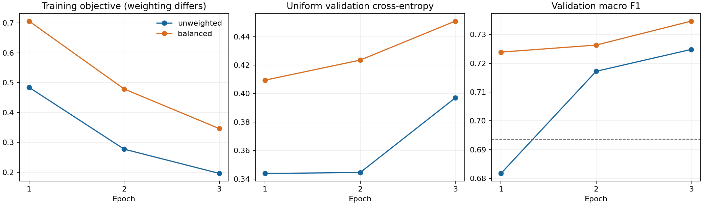

# P6 — BERT Tổng thể cảm xúc: huấn luyện & Đánh giá

Ngày2026-10-15 (Asia/Saigon). **P6 hoàn thành: P6-T01–T06** theo PLAN_AI §9 và PLAN_HUMAN chặng6. Hai lượt fine-tune BERT thực sự, mỗi lượt đủ21.000 review × 3epochs; không thay bằng kiểm tra cơ bản kiểm thử. **Không thực thi giai đoạn P7**, ABSA, frontend, API hoặc thu thập dữ liệu. P0–P5 datasets/artifacts được bảo toàn.

## A. Phạm vi và nghiệm thu từng tác vụ

| Nhiệm vụ | Thực hiện | Trạng thái | Bằng chứng |
|---|---|---|---|
| P6-T01 | PyTorch bộ dữ liệu adapter, giữ IDs/labels, đặc trưng allowlist | DONE | `src/sentiment/bert.py`, kiểm tra căn chỉnh full30k + thiết bị cố định |
| P6-T02 | Tái sử dụng tokenizer/truncation P4, đệm động, max_length512 | DONE | `input_validation.json`, mã hóa lại token đầy đủ, băm đã cố định P4 |
| P6-T03 | Tinh chỉnh đầy đủ BERT, loss/history/macro F1, điểm lưu mô hình tốt nhất | DONE | 6đầy đủ vòng huấn luyện, `training_history.json`, 2 thư mục điểm lưu mô hình tốt nhất |
| P6-T04 | So sánh uniform/weighted hàm mất mát bằng tập xác thực | DONE | 2 ứng cử viên độc lập, trọng lượng chỉ trên tập huấn luyện, được chọn cân bằng |
| P6-T05 | Số liệu phân loại, times/latency/size/RAM/VRAM | DONE | `metrics.json`, CSV nhầm lẫn, `benchmark.csv`, `environment.json` |
| P6-T06 | Mức tăng và chi phí BERT so với LR/SVM/DT, | DONE | bảng thống nhất5model và `cost_performance_deltas.csv` |

lần chạy bằng chứng: `reports/p6/p6_20261015/`; models/predictions: `artifacts/models/p6_20261015/`; derived plots/deltas: `reports/p6/p6_20261015_analysis/`; usage: `docs/P6_MODEL_CONTRACT.md`. Controlled basic diagnostics dưới đây đáp ứng brief P6, không check các tác vụ P7. Không có ngưỡng bắt buộc BERT phải thắng LR trong official PLAN.

## B. Các phụ thuộc, tính toàn vẹn và giao thức của dữ liệu

Đã đọc AGENTS/handoff, P6 chính thức của hai PLAN, P4/P5 reports/contracts, configs/model mapping, P4 preprocessors, hiện có registry/tests và các tệp kết quả. tái sử dụng `p4_20261009_final`, không chạy lại P0–P5 preparation/training. nguồn P2 SHA256 vẫn `611b73584a933645336784b13b7f004a17e8803758d1be8ac64708563eabb5ba`.

| phân chia | review | Sản phẩm | Tiêu cực | trung tính | tích cực |
|---|---:|---:|---:|---:|---:|
| tập huấn luyện |21.000 |6.357 |5.781 |1.842 |13.377 |
| tập xác thực |4.500 |1.361 |1.239 |395 |2.866 |
| kiểm thử |4.500 |1.362 |1.239 |394 |2.867 |

hạt giống ngẫu nhiên42, fixed70/15/15, product/component-disjoint. Rechecked cross-phân chia ID, parent/asin, split_group_id, exact text/hash overlaps0. đã tái sử dụng bounded near- trùng lặp bằng chứng P4, not exhaustive semantic proof. All181protected đầu vào checksums PASS trước/sau lần chạy và độc lập audit: raw/P2/P3/P4 và P5 các mô hình/ metrics/predictions/implementation. Không sửa nguồn dữ liệu, nhãn đại diện, các tập đã chia hoặc P4 preprocessing. P3 trước đây đã descriptive EDA toàn corpus; không gọi kiểm thử là chưa bao giờ được xem. Từ mô hình lựa chọn onward, kiểm thử không dùng tune.

Adapter giữ review IDs riêng, chỉ chuyển input_ids/attention_mask/token_type_ids/ nhãn vào mô hình; dtype int64, CLS101/SEP102/PAD0, mask1 trước padding, typeIDs0. Mọi token row/target/order khớp parquet P4; reencode **toàn bộ30k** bằng bộ tách token cũ đều khớp. Vocab30522 tương thích BERT. Right truncation/max512 lấy nguyên từ tập huấn luyện-derived P4 p95=390; dynamic right padding theo lô. Không giảm context, bỏ review, khớp mô hình bộ tách token hoặc đưa rating/product siêu dữ liệu vào predictor. Truncation khoảng3,1% là giới hạn P4, không đổi policy sau khi xem heldouts. Negation/punctuation giữ nguyên qua minimal chuẩn hóa; uncased đã huấn luyện trước bộ tách token tự lowercase/normalize accents. SemEval và gold không dùng tập huấn luyện overall.

P5 kiểm thử đã được đánh giá trước P6; P6 grid/protocol được chốt độc lập với feedback kiểm thử, chỉ tập xác thực chọn checkpoint/loss mode. Không tập huấn luyện lại P5 hoặc dùng kiểm thử để chọn learning rate/epochs. Sau lựa chọn lock, chỉ một toàn bộ kiểm thử pass cho BERT đã chọn. Validators tính lại từ saved predictions, không predict kiểm thử lần nữa.

## C. điểm lưu mô hình, môi trường và cấu hình

đã huấn luyện trước: [google-bert/bert-base-uncased, đã ghim phiên bản revision](https://huggingface.co/google-bert/bert-base-uncased/blob/86b5e0934494bd15c9632b12f734a8a67f723594/README.md), declared Apache2.0, nguồn revision trùng P4. Chỉ tải official `model.safetensors`; SHA256 `68d45e234eb4a928074dfd868cead0219ab85354cc53d20e772753c6bb9169d3`. mạng nền đã huấn luyện trước đầy đủ; loading chỉ thiếu classifier.weight/bias mới và bỏ MLM/NSP heads không thuộc task. Classification head3labels: negative0/neutral1/ positive2. Không dùng một cảm xúc điểm lưu mô hình fine-tune từ nguồn không rõ.

Windows11/Python3.13.12, `.venv`: torch2.8.0+cu128, Transformers5.0.0, tokenizers0.22.1, HF Hub1.33.0, safetensors0.8.0, sklearn1.7.2. [Official CUDA12.8 PyTorch installation source](https://pytorch.org/get-started/previous-versions/). RTX4050Laptop GPU, VRAM6.438.780.928bytes, CUDA runtime12.8/driver581.04. Preflight có khoảng3,14GB available RAM/68,86GB disk; trước tập huấn luyện sau thiết lập khoảng 2,35GB RAM/54,59GB disk. Default workstation Python sklearn1.8.0 không dùng. Thêm deps trong requirements, không upgrade các pins P0–P5, không đổi driver.

| Cài đặt | Giá trị thực thi |
|---|---|
| Chủ đề CPU Seed/native |42 /2 |
| Trình tối ưu hóa | AdamW, lr2e-5, weight_decay0,01 |
| Người lập lịch trình | Phân rã tuyến tính, khởi động Cập nhật theo kế hoạch 10% |
| Batch/accumulation |8 /4; nominal effective lô32; cuối vòng huấn luyện dùng group thực tế |
| vòng huấn luyện |3/candidate;2candidates; đủ21k mỗi vòng huấn luyện |
| Validation/eval lô | Cuối mỗi vòng huấn luyện /16 |
| độ chính xác dự đoán (precision) | CUDA tập huấn luyện FP16 autocast+GradScaler; validation/test/inference FP32 |
| Điều khiển bộ nhớ | SDPA, điểm kiểm tra độ dốc, nhóm chiều dài num_workers0, tập huấn luyện |
| Clip/early dừng | Định mức gradient1,0 / kiên nhẫn1, cải tiến macro F1 tập xác thực nghiêm ngặt |
| Ngân sách tài nguyên |Thời gian chạy 4 giờ /quy trình 6GB Đầu ra chạy RSS /4GB, kiểm tra ranh giới hoạt động mềm |

hạt giống ngẫu nhiên khởi tạo lại giống nhau cho hai các ứng viên; chỉ trên tập huấn luyện length-bucket sampler đổi thứ tự theo hạt giống ngẫu nhiên+vòng huấn luyện, bảo toàn mỗi mẫu một lần/epoch. Tất cả parameters mạng nền trainable. Real đã huấn luyện trước kiểm tra cơ bản trên3train samples: finite hàm mất mát1,16468, logits3×3 và backward đến mạng nền PASS; không optimizer step, mô hình tải lại trước toàn bộ tinh chỉnh. độc lập audit kiểm tra embeddings/query weights **đã đổi** so với đã ghim phiên bản nguồn, xác nhận không chỉ load đã huấn luyện trước hoặc tập huấn luyện head riêng.

Balanced weights từ tập huấn luyện: negative1,2108631 / neutral3,8002172 / positive0,5232862 = n/(3*số lượng). Weighted per-example CE lấy mean, expected weight1; không lô-sum-of-weights normalization. tập xác thực hàm mất mát luôn uniform CE. Đây là hàm mất mát thang đo khác uniform tập huấn luyện hàm mất mát, không so trực tiếp hai objective. Không resample heldouts. Neutral chỉ8,77% tập huấn luyện nên so sánh weights có cơ sở; quyết định cuối dựa tập xác thực, không mặc định weighting luôn tốt.

## D. huấn luyện history và lựa chọn

| Chế độ hàm mất mát | vòng huấn luyện | Mục tiêu tập huấn luyện | tập xác thực CE | tập xác thực macro F1 | tập xác thực neutral F1 |
|---|---:|---:|---:|---:|---:|
| Không có trọng số |1 |0,484357 |0,343868 |0,681706 |0,247232 |
| Không có trọng số |2 |0,277465 |0,344457 |0,717197 |0,350282 |
| Không có trọng số |3 |0,196322 |0,396950 |0,724805 |0,374194 |
| Cân bằng |1 |0,706045 |0,409383 |0,723873 |0,405014 |
| Cân bằng |2 |0,478942 |0,423474 |0,726308 |0,422907 |
| **Cân bằng** |**3** |**0,346292** |**0,450890** |**0,734646** |**0,427451** |

Best: **balanced vòng huấn luyện3**, chọn theo macro F1; exact ties giữ epoch/candidate trước. Early stopping được cấu hình nhưng không trigger vì mỗi vòng huấn luyện macro F1 tăng. Balanced hơn unweighted best0,009842 tập xác thực macro F1; chưa có significance test/multi-seed claim. Uniform tập xác thực CE tăng dù tập huấn luyện objective giảm và F1 tăng: cảnh báo overconfidence/overfitting và trade-off weighting, không che giấu bằng lựa chọn lại theo test/loss. Online tập huấn luyện objective có dropout và trajectory khác cuối cùng eval; không coi gap đó là một phép đo tập huấn luyện-eval hàm mất mát cùng điều kiện. Không calibration/probability-confidence claim.

6full vòng huấn luyện,126.000 mẫu exposures;3.938optimizer updates. AMP ghi4skipped updates do GradScaler giảm scale (1unweighted vòng huấn luyện1;2balanced vòng huấn luyện1;1balanced vòng huấn luyện3); không NaN tập huấn luyện hàm mất mát, không drop đầu vào rows. Logs/history giữ nguyên counts/skips, không bịa đủ mọi planned optimizer update. Mỗi ứng viên chỉ giữ một best điểm lưu mô hình, không lưu nhiều vòng huấn luyện dư thừa hoặc optimizer states lớn. Không có exact mid-vòng huấn luyện resume; interrupted khớp mô hình cần mới lần chạy, best các tệp kết quả được giữ.

`selection_lock.json` bind được chọn mode/epoch/config/weights hàm băm **trước kiểm thử**. Reloaded tập xác thực macro F1 khớp0,7346463550. kiểm thử macro F1=0,7302042742, tỷ lệ dự đoán đúng (accuracy)0,8528888889, weighted F1=0,8641548556, macro độ chính xác dự đoán (precision)0,7201219387, macro độ bao phủ (recall)0,7520088687, uniform CE0,4264254235. Không dùng kiểm thử để đổi lựa chọn.

biểu đồ đã render/visual QA: dashed line là LR tập xác thực macro F1; tập huấn luyện objective giữa modes khác weighting. Có bản SVG để export, không suy luận ngoài3epochs.

## E. P5–P6 đánh giá so sánh hợp nhất và chi phí

| mô hình | tập xác thực macro F1 | kiểm thử macro F1 | kiểm thử tỷ lệ dự đoán đúng (accuracy) | Trọng số F1 | Trung tính F1 |
|---|---:|---:|---:|---:|---:|
| Đa số |0,259390 |0,259445 |0,637111 |0,495886 |0,000000 |
| LR |0,693554 |0,683887 |0,807333 |0,824430 |0,350746 |
| SVM tuyến tính |0,687509 |0,678138 |0,847556 |0,841337 |0,282014 |
| DT |0,527902 |0,530962 |0,736222 |0,717325 |0,127367 |
| **BERT cân bằng vòng huấn luyện3** |**0,734646** |**0,730204** |**0,852889** |**0,864155** |**0,404883** |

Primary research question: BERT hơn SVM **0,052066 macro F1** (5,21F1 points), neutral F1+0,122869, tỷ lệ dự đoán đúng (accuracy)+0,005333. So LR: macro F1+**0,046317**, neutral F1+0,054137, tỷ lệ dự đoán đúng (accuracy)+0,045556. BERT được chọn từ tập xác thực, không chọn lại vì kiểm thử. Đây là point estimates trên đại diện labels/one hạt giống ngẫu nhiên, không superiority claim với con người cảm xúc hoặc statistically significant/cross-domain generalization.

| Chi phí | LR P5 | SVM P5 | BERT đã chọn | BERT/LR | BERT/SVM |
|---|---:|---:|---:|---:|---:|
| Đã chọn mô hình khớp mô hình (các) |3,026 |0,982 |1.000,980 |330,84× |1.019,33× |
| Tất cả ứng viên lượt khớp mô hình (s) |11,284 |4,911 |2.530,068 |224,21× |515,21× |
| Văn bản suy luận (ms/review) |0,3152 |0,3202 |20,1464 |63,92× |62,91× |
| suy luận tệp kết quả byte |1.026.857 |1.026.660 |438.676.072 |427,20× |427,28× |
| RSS cao nhất của quy trình được lấy mẫu (GB) |0,3943 |0,4070 |3,0324 |Tổng số quá trình; không dành riêng cho công cụ ước tính | |

BERT toàn bộ thời gian chạy3.136,107s =52,27 phút; tìm kiếm ứng viên bao gồm validation/save 2.939,498s. Đã chọn khớp mô hình1.000,980 giây =16,68 phút, tổng ứng viên1.201,127 giây. Hai chế độ khớp mô hình sum2.530,068s =42,17 phút. Toàn bộ đầu ra chạy trước các dẫn xuất manifest/report877.519.571byte. Tệp có trọng lượng tốt nhất437.961.700byte; hoàn thành thư mục suy luận đã chọn438.676.072bytes. Ngân sách tài nguyên đã đáp ứng mà không tăng. Quá trình cao điểm RSS3.032.416.256byte; CUDA được phân bổ2.304.879.616byte, dành riêng2.772.434.944byte. Đỉnh cao của GPU Torch loại trừ các ứng dụng driver/other.

Độ trễ: 128 review đầu của tập xác thực, khởi động 1 lần/lặp 5 lần, trung vị thời gian mỗi hàng, đồng bộ GPU; gồm làm sạch văn bản/tách token/truyền xuôi, không gồm tải đĩa; BERT dùng lô nội bộ 16. P5 lịch sử trên CPU và P6 CUDA khác thiết bị/lô xử lý, nên các tỷ số là **chi phí tài nguyên quan sát được**, không phải tỷ số tốc độ nhân quả chỉ do kiến trúc trong điều kiện kiểm soát hoặc độ trễ một yêu cầu. Lấy mẫu RSS mỗi 20 ms, gồm môi trường chạy/đầu vào/các cấp phát trước. Thời gian unweighted/balanced cũng khác do bộ nhớ đệm/điều kiện máy; không khẳng định trọng số tự làm huấn luyện nhanh hơn.

BERT cung cấp vùng phủ sóng đại diện macro/neutral tốt hơn với chi phí memory/latency/size đáng kể. LR/SVM vẫn là các tùy chọn hợp lệ cho ứng dụng CPU nhẹ. Không có lựa chọn Streamlit hoặc triển khai sản xuất nào được triển khai; giữ mô hình tải bên ngoài giao diện người dùng.

## F. Kiểm soát chẩn đoán lỗi sau khóa

Lỗi 662/4.500proxy (14,71%) so với LR867 (19,27%). Ma trận sử dụng các cột rows/predicted thực, nhãn negative/neutral/positive:

| Đúng → Dự đoán | Tiêu cực | trung tính | tích cực |
|---|---:|---:|---:|
| Tiêu cực |1.051 |159 |29 |
| trung tính |123 |199 |72 |
| tích cực |48 |231 |2.588 |

Âm P/R/F1=0,8601/0,8483/0,8541; trung lập0,3379/0,5051/0,4049; dương0,9624/0,9027/0,9316. Trung tính vẫn yếu nhất:199/394 đã phục hồi,390dự đoán neutral sai trong số589đầu ra trung tính. Dương→âm48 so với LR112; negative→dương29 so với LR59. Trung tính → âm123 so với LR122 hầu như không thay đổi. Lỗi ghép nối: cả hai đều sai451; chỉ BERT sai211; chỉ LR sai416; cả hai đều đúng 3.422. Net205fewer đại diện lỗi, nhưng BERT không cải thiện từng review riêng lẻ.

| Lát cố định (chồng chéo) | Hàng | lỗi BERT/tỷ lệ | Lỗi/tỷ lệ LR |
|---|---:|---:|---:|
| Tín hiệu phủ định |2.603 |436 /16,75% |601 /23,09% |
| Tín hiệu từ vựng tích cực+negative |216 |51 /23,61% |58 /26,85% |
| 5 từ |143 |12 /8,39% |12 /8,39% |
| >200 từ |431 |83 /19,26% |98 /22,74% |
| Cue kỹ thuật, không có lời cảm xúc cố định |231 |40 /17,32% |NOT_MEASURED |

Phần kỹ thuật là một phương pháp phỏng đoán từ vựng nhỏ cố định từ văn bản kiểm thử đã lưu; không phải là một máy dò ngữ nghĩa được xác nhận. Các cờ trùng nhau, không tính tổng mẫu số hoặc coi các tỷ lệ này là lỗi cảm xúc thực sự. Sarcasm/actual văn bản xếp hạng nhiễu vẫn giữ nguyên NOT_MEASURED mà không có sự xét xử con người. Ngưỡng chẩn đoán cố định không điều chỉnh mô hình.

Ví dụ hạt giống ngẫu nhiên42queue42, lên lát to5/off-diagonal ô plus3/flag, loại bỏ ID trùng lặp. Codex read12examples (2/cell), **Chỉ kiểm tra định tính AI**, không có con người nhãn:

- Tiêu cực→neutral `31616119` thảo luận về phần mềm bị thiếu không mong muốn; `8475221`
  là một khiếu nại tốc độ ngắn mạnh mẽ. text/strength mô tả có thể bị đánh giá thấp.
- Tiêu cực→positive `4772794` khen ngợi tốc độ sau đó thêm cập nhật pin chết; BERT
  bỏ lỡ trải nghiệm đã thay đổi. `35357716` đề cập đến headline/context vắng mặt trong khi thân máy phát ra âm thanh positive; không thể xác nhận sự mỉa mai hoặc nhiễu nhãn.
- Trung lập→negative `17480926`/`25501833` thảo luận về lỗi screen/fan/charging và
  sửa chữa. đại diện3stars có thể cùng tồn tại với ngôn ngữ negative; không tự động sửa nhãn.
- Trung tính→positive `11089856` kết hợp nhược điểm của CPU/bloatware với ưu điểm của value/design;
  `4575926` kết hợp khả năng tương thích phần mềm bị phủ định và cách sử dụng positive.
- Tích cực→negative `37483758` thiếu bối cảnh sản phẩm; `6170950` phàn nàn về
  condition/warranty mặc dù có xếp hạng positive đại diện. Khả năng không phù hợp, chưa được chứng minh nhiễu.
- Tích cực→neutral `8192912` và `21975557` khen ngợi hiệu suất nhưng chỉ trích
  keyboard/finish hoặc overheating/connectivity. Một nhãn tổng thể duy nhất là không rõ ràng.

Không sử dụng các trường hợp sau kiểm thử này để điều chỉnh lại P6 đã được đánh giá. Chi tiết P7 vẫn là đang chờ; không thực hiện danh sách kiểm tra ABSA nhãn gán hoặc P7 được suy ra từ chẩn đoán từ vựng.

## G. Kiểm tra, tập xác thực và cảnh báo ghi nhật ký

- `python -m scripts.test_all`: cuối cùng **195P0–P5 PASS13,38 giây +12P6 PASS13,73 giây**;
  tổng207PASS,0FAIL trong hai mới processes. No old test/assertion/budget changes.
- Đồ đạc P6: Bảo quản adapter/shape/dtype/ID, loại bỏ tham nhũng, bộ tách token/
  Khả năng tương thích mô hình, phần đệm, chỉ trên tập huấn luyện weights/sampling, forward/backward, xác định suy luận, đầu vào device/language/empty, lựa chọn tốt nhất serialization/tamper,, tách train/eval từ đầu đến cuối, nhóm tích lũy một phần cuối cùng. Đèn sử dụng BERT/local tổng hợp ngẫu nhiên cực nhỏ bộ tách token; không có khiếu nại downloads/benchmark.
- `python -B -m scripts.validate_p6`: **Băm exit0/PASS**,181input, lựa chọn,
  tập huấn luyện vòng huấn luyện đầy đủ, đã lưu truy vấn predictions/metrics/confusions/CSV, CPU reload/inference, embeddings/encoder được cập nhật từ nguồn đã huấn luyện trước được ghim. kiểm thử không được dự đoán lại.
- `python -m pip check`: Không tìm thấy yêu cầu nào bị hỏng. `compileall -q src scripts`: thoát0.
- `python -B -m scripts.report_p6`: exit0/PASS; PNG/SVG được hiển thị và kiểm tra trực quan.
- QA observations/verification-source cuối cùng và băm phân tích:
  `reports/p6/p6_20261015_qa.json`. Bản ghi này đã quan sát thấy commands/results; bằng chứng hoạt động hoàn toàn bất biến vẫn bị ràng buộc bởi bản kê ban đầu của nó.

`pytest -q` initially20FAIL/187PASS nguyên khối: Torch được nhập trong quá trình thu thập vượt quá ngân sách xử lý dữ liệu-phase512MB trước đó. Trình chạy được ghi lại tách biệt các thử nghiệm được lập ngân sách cũ khỏi Torch; mọi kiểm thử được yêu cầu đều vượt qua mà không cần nới lỏng các tấm bảo vệ. Sử dụng trình chạy đó, thay vì coi bộ sưu tập nặng về bộ nhớ là hồi quy dữ liệu.

Lệnh shell huấn luyện đã sử dụng chuyển hướng PowerShell `*>`; Các báo cáo của người đứng đầu nhiệm vụ MISSING/UNEXPECTED đã huấn luyện trước dự kiến ​​​​của HF về stderr được gói dưới dạng `NativeCommandError` và trình bao bọc đó trả về1. Bảng điều khiển kết thúc với đường dẫn DONE JSON, bản kê hoàn chỉnh và đầu ra; **không yêu cầu trình bao bọc exit0**. tập xác thực exits0/PASS độc lập và xác minh training/checkpoints. đã hoàn thành Không có dấu vết huấn luyện, trạng thái BLOCKED tệp kết quả hoặc epoch/output bị thiếu. Bảng điều khiển thô tại `reports/p6_training_console_20261015.log` duy trì cảnh báo này.

## H. Thay đổi kho lưu trữ

Mới: `configs/p6.yaml`; `src/sentiment/bert.py`; `scripts/train_p6.py`, `validate_p6.py`, `report_p6.py`, `test_all.py`; `tests/test_p6.py`; `docs/P6_MODEL_CONTRACT.md`; báo cáo này và run/analysis các tệp kết quả mới. Đã cập nhật: `src/models/registry.py` để tải BERT/classical được lưu lười biếng, `requirements.txt` để ghim các phần phụ thuộc P6 thực tế, hai PLANs/README/handoff. Không bị xóa source/data/artifact, architecture/backend/database mới hoặc đầu ra P5 bị ghi đè. Các văn bản weights/predictions/diagnostic lớn vẫn nằm trong các tệp kết quả bị bỏ qua.

## Tôi-J. Hạn chế và kết luận

Hoàn tất chấp nhận P6: lựa chọn dữ liệu tinh chỉnh đầy đủ thực, điểm lưu mô hình có thể tải lại hợp lệ, lựa chọn tập xác thực-đã cố định, một thẻ kiểm thử, tất cả đều được yêu cầu metrics/costs/comparison, độc lập tập xác thực, hoàn toàn bắt buộc Vùng phủ sóng kiểm thử và đầu vào được bảo vệ không thay đổi. Không còn vật phẩm P6 BLOCKED nào. Đầu ra mô hình độ tin cậy vẫn rỗng; các khía cạnh trống rỗng vì tổng thể chỉ có phạm vi. Thử nghiệm Single-seed/bounded và neutral độ chính xác dự đoán (precision) yếu vẫn còn hạn chế, chưa có cổng ẩn hoặc tuyên bố calibration/generalization.

Luôn giữ lại **các kết quả chỉ dành cho laptop**, **nhãn đại diện suy từ số sao-nhiễu nhãn**, **chuyển đổi SemEval-to-Amazon platform/style trong laptop review**, **được chú thích nhỏ theo cách thủ công bộ dữ liệu gold** (P10 bộ gold do con người gán nhãn vẫn vắng mặt). không trùng sản phẩm giữa các tập không ngụ ý brand/user/time-disjoint hoặc đại diện thị trường. SemEval source/license vẫn là NOT_VERIFIED theo ngoại lệ giáo dục của chủ sở hữu trước đó; không kiểm toán lại hoặc viết lại xuất xứ.

NEXT_ACTION: Lỗi P7 Phân tích taxonomy/negation theo một yêu cầu riêng (PLAN không chỉ định ID P7-Txx). Dừng lại ở P6 ngay bây giờ; không bắt đầu triển khai P7/ABSA/frontend.
